<div align="center">

# 🎃 Fortnite Chest Counter
### Счётчик сундуков Fortnite / Chest counter for Fortnite

Стильный оверлей-счётчик сундуков для ивентов охоты за сокровищами.
Считает вручную — одной горячей клавишей, показывая шанс выпадения жетона.

**A stylish always-on-top chest counter overlay for treasure-hunt events.
Manual one-hotkey counting with a live token-chance display.**

[](../../releases)
[](../../actions/workflows/build.yml)
[](#)
[](#)
[](LICENSE)
[](#)

<p align="center">
  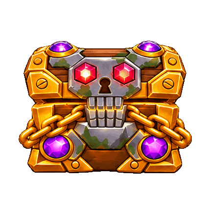
</p>

[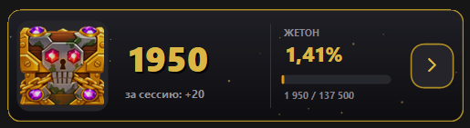](docs/screenshot-counter.png)
[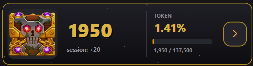](docs/screenshot-counter-en.png)

*Слева — русский интерфейс / Left — English UI*

</div>

---

## 🇷🇺 Русский

### ✨ Возможности

- 🎃 **Оверлей поверх игры** — золотая панель со сундуком, который открывается при каждом +1
- 🎲 **Шанс на жетон** — живой процент вероятности, что жетон уже выпал (официальный шанс — 1 к 137 500 сундуков), с прогресс-баром
- ⌨️ **Горячие клавиши** — одиночные клавиши или сочетания **Ctrl / Alt / Shift + клавиша**, переназначаются в настройках
- 🗺️ **Карты с сундуками** — оверлей с фото карт: размер, прозрачность, свои картинки
- 🌗 **Прозрачность** — ползунки для панели и окна карты
- 🧙 **Мастер первой настройки** — язык, стартовый счёт и клавиши за 30 секунд
- 🌐 **Русский и английский** интерфейс — переключение на лету
- ✨ **Искры** на фоне панели

### 🛠 Как это работает

Счётчик **не читает память игры** и ничего в неё не внедряет — это обычные окна поверх игры
(как оверлей Discord). Вы нажимаете горячую клавишу после каждого открытого сундука.

Вероятность жетона считается честно: с одного сундука шанс `1/137500`,
после N сундуков вероятность, что жетон уже выпал: `1 − (1 − 1/137500)^N`.

### 📸 Скриншоты

<p align="center">
  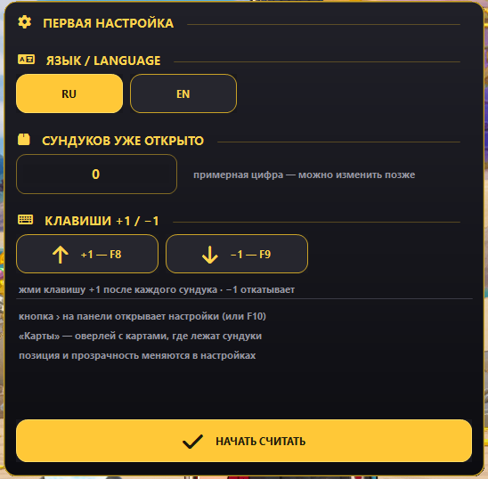
  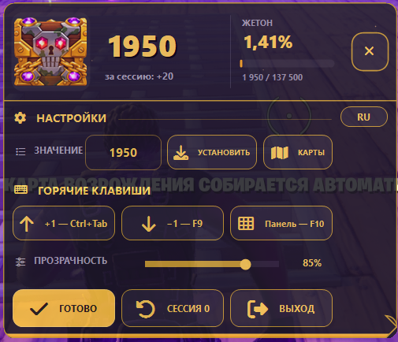
  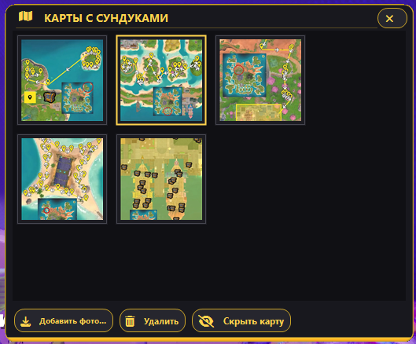
  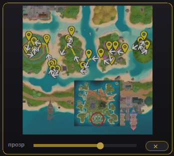
</p>

### 📥 Установка

1. Скачайте `FortniteChestCounter-v1.0.0.zip` со страницы [Releases](../../releases)
2. Распакуйте в любую папку
3. Запустите `FortniteChestCounter.exe` — мастер первой настройки всё сконфигурирует

> 💡 Для видимости оверлея в игре выберите **«Оконный полный экран»** (Windowed Fullscreen)
> в настройках графики Fortnite.

### ⌨️ Управление (по умолчанию)

| Клавиша | Действие |
|---|---|
| `F8` | +1 сундук |
| `F9` | −1 откат |
| `F10` | Открыть/закрыть настройки |

Клавиши переназначаются в настройках на любые — включая сочетания `Ctrl/Alt/Shift + клавиша`.
Кнопка **«›»** на панели также открывает настройки мышкой.

### 🗺️ Карты

Кнопка **«Карты»** открывает менеджер: выбирайте фото карт с расположением сундуков,
добавляйте свои (`jpg/png/bmp`), удаляйте лишние. Выбранная карта показывается отдельным
окном с регулировкой размера (за края) и прозрачности (ползунок).

### 🔨 Сборка из исходников

Не нужен Visual Studio — используется компилятор `csc.exe`, встроенный в Windows (.NET Framework 4.x):

```bat
build.bat
```

Готовый exe появится в `bin\`. Иконку можно пересоздать через `tools\make_icon.ps1`.

Либо просто пуши изменения — **GitHub Actions** соберёт exe автоматически
(вкладка [Actions](../../actions/workflows/build.yml) → артефакты; на тегах `v*` exe прикрепляется к релизу).

---

## 🇬🇧 English

### ✨ Features

- 🎃 **Game overlay** — gold panel with a chest that opens on every +1
- 🎲 **Token chance** — live probability that the token has already dropped (official odds — 1 in 137,500 chests) with a progress bar
- ⌨️ **Hotkeys** — single keys or **Ctrl / Alt / Shift + key** combos, rebindable in settings
- 🗺️ **Chest maps** — overlay with map photos: size, opacity, your own images
- 🌗 **Opacity** — sliders for the panel and the map window
- 🧙 **First-run setup wizard** — language, starting count and keys in 30 seconds
- 🌐 **Russian & English** UI — switch on the fly
- ✨ **Sparks** particle background

### 🛠 How it works

The counter **never reads game memory** and does not inject anything — it is just
regular topmost windows (like the Discord overlay). You press a hotkey after each opened chest.

The token chance is computed honestly: `1/137500` per chest,
after N chests the probability the token has dropped is `1 − (1 − 1/137500)^N`.

### 📸 Screenshots

<p align="center">
  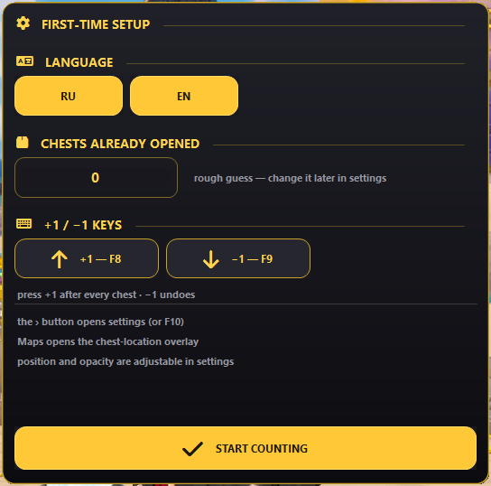
  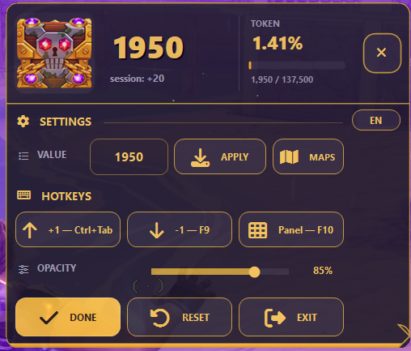
  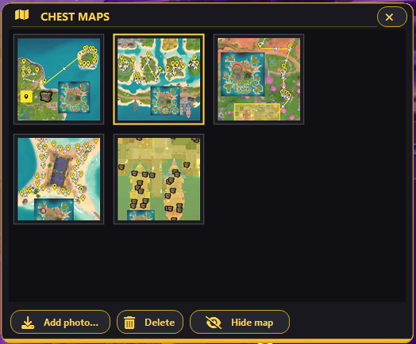
  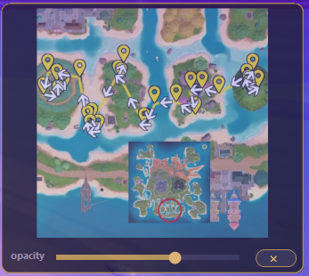
</p>

### 📥 Install

1. Download `FortniteChestCounter-v1.0.0.zip` from the [Releases](../../releases) page
2. Extract it anywhere
3. Run `FortniteChestCounter.exe` — the first-time setup wizard will guide you

> 💡 To see the overlay in-game select **Windowed Fullscreen**
> in the Fortnite display settings.

### ⌨️ Controls (defaults)

| Key | Action |
|---|---|
| `F8` | +1 chest |
| `F9` | −1 undo |
| `F10` | Toggle settings panel |

Keys are rebindable to anything — including `Ctrl/Alt/Shift + key` combos.
The **›** button on the panel also opens the settings with the mouse.

### 🗺️ Maps

The **Maps** button opens the manager: pick chest-location map photos, add your own
(`jpg/png/bmp`), delete the ones you don't need. The selected map is shown in a separate
window with edge-resizing and an opacity slider.

### 🔨 Build from source

No Visual Studio required — the build script uses the `csc.exe` compiler shipped with
Windows (.NET Framework 4.x):

```bat
build.bat
```

The exe is placed into `bin\`. Regenerate the icon via `tools\make_icon.ps1`.

Or just push your changes — **GitHub Actions** builds the exe automatically
(the [Actions](../../actions/workflows/build.yml) tab → artifacts; on `v*` tags the exe is attached to the release).

---

<div align="center">

## ⚠️ Disclaimer

This project is **not affiliated with or endorsed by Epic Games**.
Fortnite is a trademark of Epic Games, Inc. Use at your own risk.
The app only shows topmost windows — it never reads game memory or injects code.

**Лицензия / License:** [MIT](LICENSE) ·
Font Awesome Free icons by [Fonticons, Inc.](https://fontawesome.com/) — [CC BY 4.0](https://creativecommons.org/licenses/by/4.0/) / [OFL](https://openfontlicense.org/)

</div>
