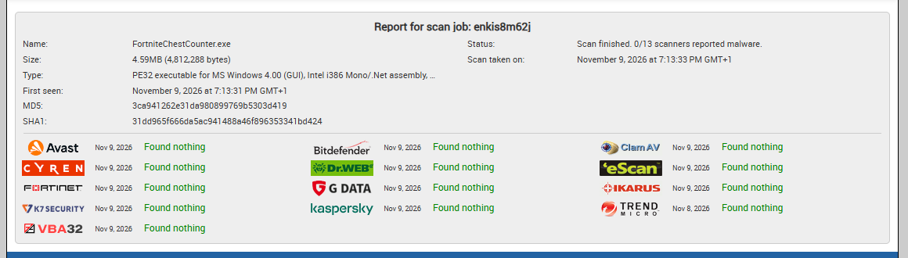

# Безопасность / Security

[🇷🇺 Русский](#русский) · [🇬🇧 English](#english)

---

## Русский

### Коротко

**В программе нет вируса.** Это открытый C#-код: 2 447 строк, ни одного сетевого
запроса, ни автозапуска, ни работы с другими процессами.

- **0 из 13 антивирусов** нашли что-либо (Kaspersky, Bitdefender, Dr.Web, Trend Micro, Avast и другие)
- Исходный код открыт — можно прочитать каждую строку
- Программа пишет только свои настройки в `%APPDATA%\FortniteChestCounter`
- Предупреждение Windows — это **отсутствие цифровой подписи**, а не вирус

### Проверка в 13 антивирусах: 0/13



Публичный отчёт (можно открыть и проверить): **https://virusscan.jotti.org/en-US/filescanjob/enkis8m62j**

Проверявшие движки: Avast, Bitdefender, ClamAV, CYREN, Dr.Web, eScan, Fortinet,
G Data, Ikarus, K7Security, Kaspersky, Trend Micro, VBA32 — все ответили **Found nothing**.

Сканер определил файл как `PE32 executable for MS Windows (GUI), Intel i386 Mono/.Net assembly`.

### Хеши файла

| Алгоритм | Хеш |
|---|---|
| SHA-256 | `b64518591e0a7b11b54fb57fb1a02bba98f2e3e076e2b2a0dc46074c39b21203` |
| SHA-1 | `31dd965f666da5ac941488a46f896353341bd424` |
| MD5 | `3ca941262e31da980899769b5303d419` |
| Размер | 4 812 288 байт (4.59 МБ) |

Проверить, что скачанный файл — тот же самый:

```powershell
Get-FileHash .\FortniteChestCounter.exe -Algorithm SHA256
```

Не совпало — файл повреждён или подменён, не запускайте.

### Что показал разбор исходного кода

Опасных вызовов нет. Прочитать и проверить можно самому:

```powershell
# сеть, запуск процессов, реестр, внедрение в процессы — должно быть пусто
Select-String -Path .\src\ChestCounter.cs -Pattern 'HttpClient|WebClient|WebRequest|Socket|TcpClient|Process\.Start|Registry|LoadLibrary|VirtualAlloc|CreateRemoteThread|WriteProcessMemory|OpenProcess'
```

**Чего в коде нет:**

| Проверка | Результат |
|---|---|
| Сетевые запросы (`HttpClient`, `WebClient`, `Socket`) | нет ни одного |
| Запуск сторонних программ (`Process.Start`, `cmd`, `powershell`) | нет |
| Реестр и автозапуск (`Registry`, Startup) | нет |
| Внедрение в другие процессы (`LoadLibrary`, `CreateRemoteThread`, `WriteProcessMemory`) | нет |
| Чтение памяти игры | нет |

**Что есть:** только `user32.dll` и `gdi32.dll` — глобальные горячие клавиши
(`RegisterHotKey`), позиционирование окна (`SetWindowPos`), перетаскивание за заголовок.

**Куда пишет на диск:** только в `%APPDATA%\FortniteChestCounter\`
- `state.txt` — счётчик и настройки
- `Maps\` — карты, которые пользователь добавляет сам

### Почему Windows пишет «вирус»

Предупреждение **«Windows защитила ваш компьютер»** (SmartScreen) — это не результат
проверки на вирусы. Файл просто **не подписан цифровой подписью**:

```powershell
(Get-AuthenticodeSignature .\FortniteChestCounter.exe).Status
# NotSigned
```

SmartScreen предупреждает про любую неподписанную программу от «неизвестного издателя»,
которую скачали мало раз — у файла нет накопленной репутации.
Точно такое же окно вы увидите у любой программы, собранной дома.

**Важно:** даже чистый скан не убирает это предупреждение. Убирает его только
сертификат подписи кода (code signing, ~200–400 $ в год) — для бесплатного
проекта это нерентабельно.

Варианты:

1. «Подробнее» → «Выполнить в любом случае».
2. **Собрать самому из исходников** — `build.bat`, компилятор `csc.exe` уже есть в Windows,
   Visual Studio не нужна. Тогда `.exe` собран на вашей машине, и предупреждения нет.
3. Загрузить файл на [VirusTotal](https://www.virustotal.com/gui/home/upload) и убедиться самому.

### Если всё равно не доверяете

Это нормально — и правильно. Тогда не запускайте `.exe` вообще:
соберите из исходников или просто прочитайте код. Никаких секретов там нет.

---

## English

### Short version

**There is no virus.** This is open C# source: 2,447 lines, no network calls,
no autostart, no interaction with other processes.

- **0 of 13 antivirus engines** detected anything (Kaspersky, Bitdefender, Dr.Web, Trend Micro, Avast and others)
- The source is open — you can read every line
- It writes only its own settings to `%APPDATA%\FortniteChestCounter`
- The Windows warning is about a **missing digital signature**, not malware

### Multi-engine scan: 0/13


Public report: **https://virusscan.jotti.org/en-US/filescanjob/enkis8m62j**

Engines: Avast, Bitdefender, ClamAV, CYREN, Dr.Web, eScan, Fortinet, G Data,
Ikarus, K7Security, Kaspersky, Trend Micro, VBA32 — all reported **Found nothing**.

The file was identified as `PE32 executable for MS Windows (GUI), Intel i386 Mono/.Net assembly`.

### File hashes

| Algorithm | Hash |
|---|---|
| SHA-256 | `b64518591e0a7b11b54fb57fb1a02bba98f2e3e076e2b2a0dc46074c39b21203` |
| SHA-1 | `31dd965f666da5ac941488a46f896353341bd424` |
| MD5 | `3ca941262e31da980899769b5303d419` |
| Size | 4,812,288 bytes (4.59 MB) |

Verify that the file you downloaded is the same one:

```powershell
Get-FileHash .\FortniteChestCounter.exe -Algorithm SHA256
```

If it does not match, the file is corrupted or tampered with — do not run it.

### What the source review shows

No dangerous calls. You can verify this yourself:

```powershell
# network, process spawning, registry, process injection — should return nothing
Select-String -Path .\src\ChestCounter.cs -Pattern 'HttpClient|WebClient|WebRequest|Socket|TcpClient|Process\.Start|Registry|LoadLibrary|VirtualAlloc|CreateRemoteThread|WriteProcessMemory|OpenProcess'
```

**Not present in the code:**

| Check | Result |
|---|---|
| Network requests (`HttpClient`, `WebClient`, `Socket`) | none |
| Launching other programs (`Process.Start`, `cmd`, `powershell`) | none |
| Registry / autostart | none |
| Injecting into other processes (`LoadLibrary`, `CreateRemoteThread`, `WriteProcessMemory`) | none |
| Reading game memory | none |

**What is used:** only `user32.dll` and `gdi32.dll` — global hotkeys (`RegisterHotKey`),
window positioning (`SetWindowPos`), dragging by the title bar.

**What it writes to disk:** only `%APPDATA%\FortniteChestCounter\`
- `state.txt` — counter and settings
- `Maps\` — maps the user adds manually

### Why Windows shows a "virus" warning

The **"Windows protected your PC"** message (SmartScreen) is not an antivirus verdict.
The file simply **has no digital signature**:

```powershell
(Get-AuthenticodeSignature .\FortniteChestCounter.exe).Status
# NotSigned
```

SmartScreen warns about any unsigned program from an "unknown publisher" that has few
downloads — the file has no accumulated reputation. You would see the same prompt for
any program you compile at home.

**Important:** even a clean scan does not remove this warning. Only a code-signing
certificate (~$200–400 per year) does — which is not worth it for a free project.

Options:

1. "More info" → "Run anyway".
2. **Build it yourself** — `build.bat`, the `csc.exe` compiler ships with Windows,
   Visual Studio is not required. The `.exe` is then compiled on your machine, with no warning.
3. Upload the file to [VirusTotal](https://www.virustotal.com/gui/home/upload) and check yourself.

### If you still don't trust it

That is fine — and reasonable. Then don't run the `.exe` at all: build it from source,
or just read the code. There are no secrets in it.
